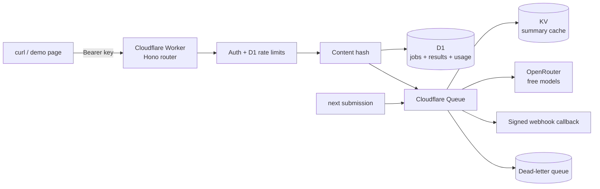
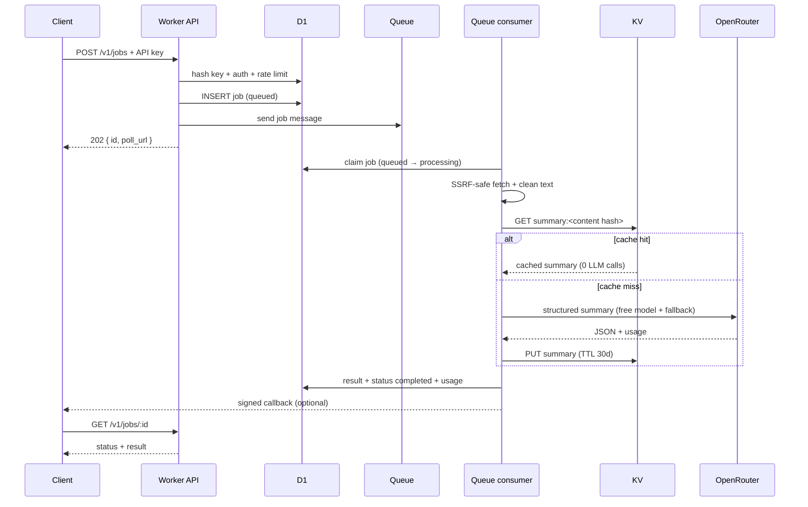

# Async AI Job Queue

A zero-cost, backend-first portfolio project: submit a URL or a block of text, get a **job id** back immediately, and poll for a grounded summary produced in the background. The queue, state machine, retries and dead-letter handling are the product; the free model is just a dependency.

Built with **TypeScript + Hono on Cloudflare Workers**, **Queues** for async delivery, **D1** as the system of record, **KV** for content-hash caching, and **free OpenRouter models** for summarization.

> Narrative: *"I built a cost-aware AI backend platform."* This is the async counterpart to the LLM Gateway and the Webhook Bot.

**Live API:** `https://async-ai-job-queue.bhalder.workers.dev` · **Demo:** `https://biswajit-halder.github.io/async-ai-job-queue/` · **Repo:** `https://github.com/biswajit-halder/async-ai-job-queue`

---

## What it does

```bash
BASE=https://async-ai-job-queue.bhalder.workers.dev

# 1. Issue an API key (admin token required)
curl -s -X POST "$BASE/admin/keys" \
  -H 'x-admin-token: <ADMIN_TOKEN>' \
  -H 'Content-Type: application/json' \
  -d '{"label":"demo"}'
# → {"key":"ajk_ab12cd34...","note":"Store this key now — only its SHA-256 hash is retained."}

# 2. Submit a job — returns immediately
curl -s -X POST "$BASE/v1/jobs" \
  -H 'Authorization: Bearer ajk_ab12cd34...' \
  -H 'Content-Type: application/json' \
  -d '{"text":"A content delivery network is a distributed group of proxy servers..."}'
# → {"id":"job_01j...","status":"queued","poll_url":"/v1/jobs/job_01j..."}

# 3. Poll until the status is completed
curl -s "$BASE/v1/jobs/job_01j..." -H 'Authorization: Bearer ajk_ab12cd34...'
```

Completed response:

```json
{
  "id": "job_01j...",
  "status": "completed",
  "kind": "summary",
  "source_type": "text",
  "source_ref": "A content delivery network is a distributed group of...",
  "attempts": 1,
  "error": null,
  "result": {
    "summary": "A CDN serves cached content from nearby edge servers...",
    "key_points": ["Edges cache content", "Misses are fetched from the origin"],
    "model": "nvidia/nemotron-3.5-lightning:free",
    "source_type": "text",
    "source_ref": "A content delivery network is a distributed group of...",
    "prompt_tokens": 812,
    "completion_tokens": 143,
    "created_at": "2026-11-23 08:00:00"
  },
  "created_at": "2026-11-23 08:00:00",
  "updated_at": "2026-11-23 08:00:02",
  "completed_at": "2026-11-23 08:00:02"
}
```

No API key handy? Use the public demo:

```bash
curl -s "$BASE/v1/demo/examples"
curl -s -X POST "$BASE/v1/demo/jobs" -H 'Content-Type: application/json' -d '{"label":"CDNs"}'
curl -s "$BASE/v1/demo/jobs/<id>"
```

After `POST /admin/seed`, demo answers come from KV — **zero OpenRouter calls**.

---

## Architecture





---

## Design decisions (locked)

| Decision | Choice | Reason |
|---|---|---|
| Response model | 202 + `GET /jobs/:id` polling, optional webhook callback | Keeps the Worker inside CPU limits and gives clients both pull and push options |
| System of record | D1, queue messages are delivery only | A queue is not a database; D1 holds state, results and usage |
| Idempotency | `sha256(kind + normalized source)` cache key + conditional `claimJob` with a state re-read | At-least-once delivery means duplicates must be harmless; never trust a `changes` count alone |
| Cache placement | KV, 30-day TTL, checked **inside the consumer** | Identical content never reaches OpenRouter, even across different job ids |
| Fetching | DNS-over-HTTPS resolution + private IP blocking + manual redirects + size/time caps | Workers cannot use `node:dns`; DNS rebinding must be blocked after hostname checks |
| Retries | Transient → exponential backoff; permanent → ack; exhausted → DLQ | Poison messages must not consume the retry budget or quota |
| Quota handling | 402 / `QUOTA_EXCEEDED` is terminal for the day; stale failures are requeued on the next submission after 24h | Never burn the 50 req/day budget on failed retries; no cron slot needed |
| Structured output | `response_format: json_schema`, `require_parameters: true`, Zod + one repair retry | Free models differ in schema support; validate rather than trust |
| Auth | `ajk_…` raw key shown once; only SHA-256 hash + prefix stored | Standard credential hygiene, consistent with the other projects |
| Errors | `{ error: { code, message, retryable, details? } }`, `Retry-After` on 429 | Same machine-readable contract across the portfolio |

### Job state machine

```
queued ──claim──▶ processing ──success──▶ completed
   │                  │
   │                  ├──transient error──▶ queued (retry) ──exhausted──▶ dead_letter
   │                  └──permanent error──▶ failed
   └──DELETE──▶ cancelled
quota failure ──▶ failed (QUOTA_EXCEEDED) ──next submission, +1 day──▶ queued
```

---

## Endpoints

| Method | Path | Auth | Purpose |
|---|---|---|---|
| POST | `/v1/jobs` | API key | Submit a `url` or `text` job → 202 |
| GET | `/v1/jobs/:id` | API key | Poll status + result |
| GET | `/v1/jobs?limit=&offset=` | API key | List jobs with pagination |
| DELETE | `/v1/jobs/:id` | API key | Cancel a still-`queued` job |
| GET | `/v1/demo/examples` | none | List canned demo inputs |
| POST | `/v1/demo/jobs` | none | Submit a demo job (daily cap) |
| GET | `/v1/demo/jobs/:id` | none | Poll a demo job |
| POST | `/admin/keys` | Admin token | Issue a key |
| GET | `/admin/keys` | Admin token | List key metadata |
| DELETE | `/admin/keys/:id` | Admin token | Revoke a key |
| POST | `/admin/seed` | Admin token | Pre-warm 3 demo answers, **zero LLM calls** |
| GET | `/admin/stats` | Admin token | Job counts by status |
| GET | `/admin/usage?key_id=&hours=` | Admin token | Cache hits vs LLM calls |
| GET | `/health` | none | Liveness |

Machine-readable spec: [`openapi.yaml`](./openapi.yaml).

---

## Setup

```bash
npm install
cp .dev.vars.example .dev.vars      # fill in OPENROUTER_API_KEY + ADMIN_TOKEN
```

Create the free-tier resources once:

```bash
npx wrangler d1 create async-ai-jobs-db
npx wrangler kv namespace create CACHE
npx wrangler queues create async-ai-jobs
npx wrangler queues create async-ai-jobs-dlq
```

Paste the D1 id and KV id into `wrangler.toml` (the file ships with zeroed placeholders), then:

```bash
npx wrangler d1 migrations apply async-ai-jobs-db --local
npx wrangler secret put OPENROUTER_API_KEY
npx wrangler secret put ADMIN_TOKEN
npm run dev        # http://localhost:8787
```

Deploy:

```bash
npx wrangler d1 migrations apply async-ai-jobs-db --remote
npm run deploy
curl -s -X POST https://<your-worker>/admin/seed -H 'x-admin-token: <ADMIN_TOKEN>'
```

`.github/workflows/ci.yml` runs typecheck + tests on every push. `.github/workflows/deploy.yml` redeploys the Worker on pushes to `main`; add `CLOUDFLARE_API_TOKEN` and `CLOUDFLARE_ACCOUNT_ID` as repo secrets to enable it. The static demo is served from the `gh-pages` branch via GitHub Pages.

Refresh `DEFAULT_MODEL` / `FALLBACK_MODELS` from <https://openrouter.ai/models?max_price=0> whenever the free roster changes. The model list used here was checked on 2026-11-23.

---

## How I stayed within 50 req/day

1. **Content-hash cache in the consumer** — the same URL or text never costs a second model call, even from different job ids.
2. **One call per unique job** — no chunk fan-out in v1; input is capped at `MAX_SOURCE_CHARS`.
3. **Seeded fixtures** — `POST /admin/seed` pre-warms three canned answers, so demos and screenshots make zero OpenRouter requests.
4. **Quota-aware backoff** — a 402 is recorded as `QUOTA_EXCEEDED` and acked rather than retried; stale failures are requeued on the next submission, a day later.
5. **Per-key D1 limits** — 50 submissions/day and 20/minute enforced before any queue or model work.
6. **Tests mock the LLM entirely** — `npm test` makes no network calls.

`GET /admin/usage?key_id=…` reports `cacheHits` vs `llmCalls`, so the claim is measurable.

---

## Testing

```bash
npm run typecheck   # strict TS, zero errors
npm test            # 55 tests; all I/O mocked, zero network calls
npm run build:check # wrangler dry-run bundle
```

Coverage includes SSRF/IP-range blocking, redirect re-validation, HTML/PDF extraction, Zod structured-output validation with repair retry, cache hits, callback signing, job state transitions, queue ack/retry/DLQ logic and quota-failure recovery. CI runs typecheck, tests and the bundle check on every push via `.github/workflows/ci.yml`.

---

## Known limitations / stretch goals

- **PDF extraction is lightweight** — reads text operators in simple PDFs; scanned or heavily compressed PDFs need a real parser.
- **DNS rebinding window** — IPs are resolved and checked immediately before fetch; a hostile DNS server could still change the answer between the two calls. Pin the resolved IP in a v2.
- **Webhook secret is queue-only** — a recovered quota failure has no callback secret in D1, so its callback is not re-sent.
- **No cron trigger** — this Cloudflare account already has 5 cron triggers (the free-tier limit), so recovery is lazy on the next submission. The `scheduled()` handler remains available if a cron slot frees up.
- **No chunking** — long documents are truncated to `MAX_SOURCE_CHARS` rather than map-reduced.
- **No auth on the demo route** — intentionally public for the portfolio demo; capped at `DEMO_DAILY_LIMIT` per day via KV.
- **Model roster changes** — the seed free models are a snapshot; refresh periodically.

---

## Interview talking points

- Why 202 + polling/callback instead of a synchronous request (CPU limits, decoupled scaling, observable state).
- How idempotency is achieved under at-least-once queue delivery (content hash + atomic claim).
- SSRF defense in Workers: DNS-over-HTTPS, IP-range blocking, redirect re-validation, size/time caps.
- Handling a hard external quota as a first-class state (`QUOTA_EXCEEDED` + lazy recovery, no cron slot required).
- How this differs from the LLM Gateway (#1: auth/cache/fallback) and Webhook Bot (#3: signature/diff/queue).
